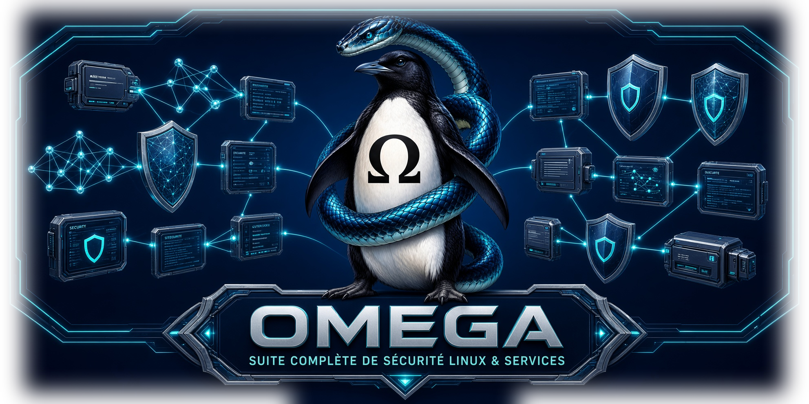
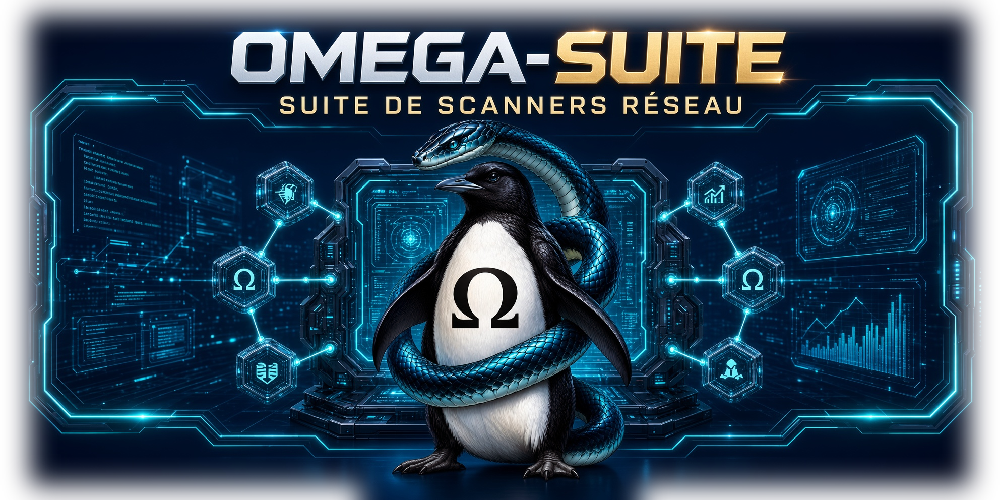

<table>
  <tr>
    <td valign="center" width="150">
      
    </td>
    <td valign="center"> 
      <strong>Kraynux</strong>  
      제어, 관리, 스캔, 로그 분석, 호스팅,
      자동화를 위한 도구와 애플리케이션을 개발하며, 신뢰할 수 있고 방어적인 웹 인프라를 지향합니다.  
      Stack: Linux, Arch, Python, C++, Shell, Bash, Lua, JavaScript, HTML, Markdown.
      </td>
        </tr>
</table>

모든 애플리케이션은 [CLEAN-ARCHITECTURE-OMEGA](https://github.com/kraynux/kraynux/blob/main/docs/translation/ko/CLEAN_ARCHITECTURE_OMEGA.md) 원칙에 따라 만들어졌습니다.   
각 프로젝트는 [PROCESS-DEVELOPPEMENT-OMEGA](https://github.com/kraynux/kraynux/blob/main/docs/translation/ko/PROCEDURE_DEVELOPPEMENT_OMEGA.md)와, [Kraynux](https://kraynux.snake-mackarel.ts.net)가 정의한 사람/AI가 번갈아 맡는 단계별 전체 관리를 따릅니다.   

모든 OMEGA- 애플리케이션은 **17개 언어**로 제공됩니다(인터페이스, 문서, 내보내기, 방문자 페이지).  
**언어:**
 [Français](../../../README.md) ·  [English](../en/README.md) ·  [Español](../es/README.md) ·  [Português (Brasil)](../pt-BR/README.md) ·  [Italiano](../it/README.md) ·  [Deutsch](../de/README.md) ·  [Nederlands](../nl/README.md) ·  [Polski](../pl/README.md) ·  [Русский](../ru/README.md) ·  [中文](../zh-CN/README.md) ·  [Tiếng Việt](../vi/README.md) ·  [ไทย](../th/README.md) ·  [Bahasa Indonesia](../id/README.md) ·  [日本語](../ja/README.md) ·  [한국어](README.md) ·  [हिन्दी](../hi/README.md) ·  [العربية](../ar/README.md)

  

   

### 주요 프로젝트 **OMEGA-**:
[FIRE](https://github.com/kraynux/omega-fire) · [SERV](https://github.com/kraynux/omega-serv) · [SUITE](https://github.com/kraynux/omega-suite) · [SCAN](https://github.com/kraynux/omega-scan) · [CHECK](https://github.com/kraynux/omega-check) · [DEEP](https://github.com/kraynux/omega-deep) · 
[FOLD](https://github.com/kraynux/omega-fold) · [STRESS](https://github.com/kraynux/omega-stress) · [TRACK](https://github.com/kraynux/omega-track) · [FUZZ](https://github.com/kraynux/omega-fuzz) · [LOG](https://github.com/kraynux/omega-log) · [WAF](https://github.com/kraynux/omega-waf) · [JAIL](https://github.com/kraynux/omega-jail) · [CONNECT](https://github.com/kraynux/omega-connect)

---

파트너 프로젝트 **ORTI-**: [WALL](https://github.com/ortipik/orti-wall) · [FILE](https://github.com/ortipik/orti-file) · [LOGS](https://github.com/ortipik/orti-logs)   

---
### [OMEGA-FIRE](https://github.com/kraynux/omega-fire)

  

 

**OMEGA-FIRE**는 TUI 기반 "**LINUX FIREWALL SUITE**" 애플리케이션으로, Linux 방화벽, Fail2Ban, 차단된 주소, 네트워크 규칙, 로그, 시스템 통계를 하나의 인터페이스로 관리할 수 있습니다.

- **외부 링크:** [공식 페이지](https://kraynux.snake-mackarel.ts.net/omega-fire/) · [스크린샷](https://kraynux.snake-mackarel.ts.net/omega-fire/screenshots) · [다운로드](https://kraynux.snake-mackarel.ts.net/omega-fire/download/) 
- **GitHub 링크:** [프로젝트 폴더](https://github.com/kraynux/omega-fire) · [모든 프로젝트](https://github.com/kraynux?tab=repositories)
- **연락처 링크:** [Mail](mailto:kraynux@proton.me) · [문의 양식](https://kraynux.snake-mackarel.ts.net/contact/)
---

### [OMEGA-SERV](https://github.com/kraynux/omega-serv)

  

 

**OMEGA-SERV**는 완전하고 강력하며 기본적으로 강화된 TUI 기반 "**LINUX SERVER SUITE**" 애플리케이션입니다.

다중 인스턴스, 통합 WAF와 능동 방어, 미리 설정된 프로필, 리버스 프록시, TLS, PHP, 별칭, 재작성, 리디렉션,
인증, 로그 관리(보기와 자동화), 백업과 복원,... 완전하고 안전하며 관리하기 쉬운 호스팅 인프라를 위한 단 하나의 제품입니다.

  

- **외부 링크:** [공식 페이지](https://kraynux.snake-mackarel.ts.net/omega-serv/) · [스크린샷](https://kraynux.snake-mackarel.ts.net/omega-serv/screenshots) · [다운로드](https://kraynux.snake-mackarel.ts.net/omega-serv/download/) 
- **GitHub 링크:** [프로젝트 폴더](https://github.com/kraynux/omega-serv) · [모든 프로젝트](https://github.com/kraynux?tab=repositories)
- **연락처 링크:** [Mail](mailto:kraynux@proton.me) · [문의 양식](https://kraynux.snake-mackarel.ts.net/contact/)
---

### [OMEGA-SUITE](https://github.com/kraynux/omega-suite)

  

 

**OMEGA-SUITE**는 완전한 TUI 기반 "**LINUX SCANNER SUITE**" 애플리케이션으로, 다음을 모았습니다:   
*Omega-Scan*, *Omega-Check*, *Omega-Deep*, *Omega-Fold*, *Omega-Stress*, *Omega-Track*, *Omega-fuzz*  
를 하나의 인터페이스와 공유 라이브러리로 제공합니다.

- **외부 링크:** [공식 페이지](https://kraynux.snake-mackarel.ts.net/omega-suite/)  · [다운로드](https://kraynux.snake-mackarel.ts.net/omega-suite/download/)
- 스크린샷 → [omega-scan](https://kraynux.snake-mackarel.ts.net/omega-scan/screenshots/) · [omega-check](https://kraynux.snake-mackarel.ts.net/omega-check/screenshots/) · [omega-deep](https://kraynux.snake-mackarel.ts.net/omega-deep/screenshots/) · [omega-fold](https://kraynux.snake-mackarel.ts.net/omega-fold/screenshots/) · [omega-track](https://kraynux.snake-mackarel.ts.net/omega-track/screenshots/) · [omega-fuzz](https://kraynux.snake-mackarel.ts.net/omega-fuzz/screenshots/) · [omega-stress](https://kraynux.snake-mackarel.ts.net/omega-stress/screenshots/)
- **GitHub 링크:** [프로젝트 폴더](https://github.com/kraynux/omega-suite) · [모든 프로젝트](https://github.com/kraynux?tab=repositories)
- **연락처 링크:** [Mail](mailto:kraynux@proton.me) · [문의 양식](https://kraynux.snake-mackarel.ts.net/contact/)
---

## OMEGA-... 전체 프로젝트:

### 보안 & 스캔

- **[omega-suite](https://github.com/kraynux/omega-suite)**  – 모든 스캔 도구를 하나의 인터페이스로.
- **[omega-scan](https://github.com/kraynux/omega-scan)** – 서버 설정 스캐너.
- **[omega-check](https://github.com/kraynux/omega-check)** – 포트와 서비스 스캐너.
- **[omega-deep](https://github.com/kraynux/omega-deep)** – 네트워크 아키텍처 스캐너.
- **[omega-fold](https://github.com/kraynux/omega-fold)** – 로컬 및 원격 폴더 스캐너.
- **[omega-stress](https://github.com/kraynux/omega-stress)** – 서버 부하 테스트 도구.
- **[omega-track](https://github.com/kraynux/omega-track)** – 경로와 웹 신원을 추적하는 디지털 추적기.
- **[omega-fuzz](https://github.com/kraynux/omega-fuzz)**  – 서버 취약점 스캐너.

### 서버 & 백엔드

- **[omega-serv](https://github.com/kraynux/omega-serv)** – 방화벽과 방어 시스템을 통합한 강화된 웹 서버.
- **[omega-fire](https://github.com/kraynux/omega-fire/)** – Linux에서의 방화벽 관리, 모니터링, 로그.
- **[omega-log](https://github.com/kraynux/omega-log)** – 서버 로그 관리 도구.
- **[omega-waf](https://github.com/kraynux/omega-waf)** – OMEGA-SERV 및 LIGHTTPD와 호환되는 서버용 WAF 엔진(magnet)
- **[omega-jail](https://github.com/kraynux/omega-jail)** – OMEGA-: SERV, FIRE, WAF에 호환되고 맞춰진 Fail2ban jail 팩.

### 라이브러리 & 유틸리티

- **[omega-connect](https://github.com/kraynux/omega-connect)** – omega- 도구를 위한 로컬 및 원격 상호 연결 유틸리티.
- **[omega-lib](https://github.com/kraynux/omega-lib)** – omega- 도구용 Python 라이브러리.

---

## Stack / 역량

- **언어:** Python, C++, Bash, Lua, SQL, HTML, JavaScript, …
- **시스템:** Linux(Arch, TCP/IP 네트워크)
- **주제:** HTTP 엔진, TLS, 애플리케이션 필터링, 커널
- **도구:** Git, Docker, Markdown, CLI 분석 도구(grep, awk, jq 등)

---

## 연락처

- **Email:**  [Mail](mailto:kraynux@proton.me)
- **문의 양식:**  [문의하기](https://kraynux.snake-mackarel.ts.net/contact/)
- **사이트 / 블로그:**  [kraynux.snake-mackarel](https://kraynux.snake-mackarel.ts.net)
- **GitHub:** [kraynux](https://github.com/kraynux)
